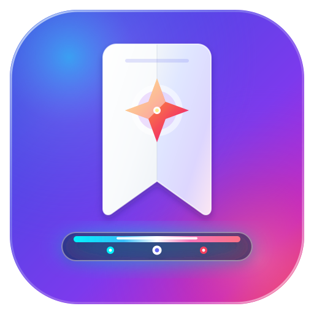
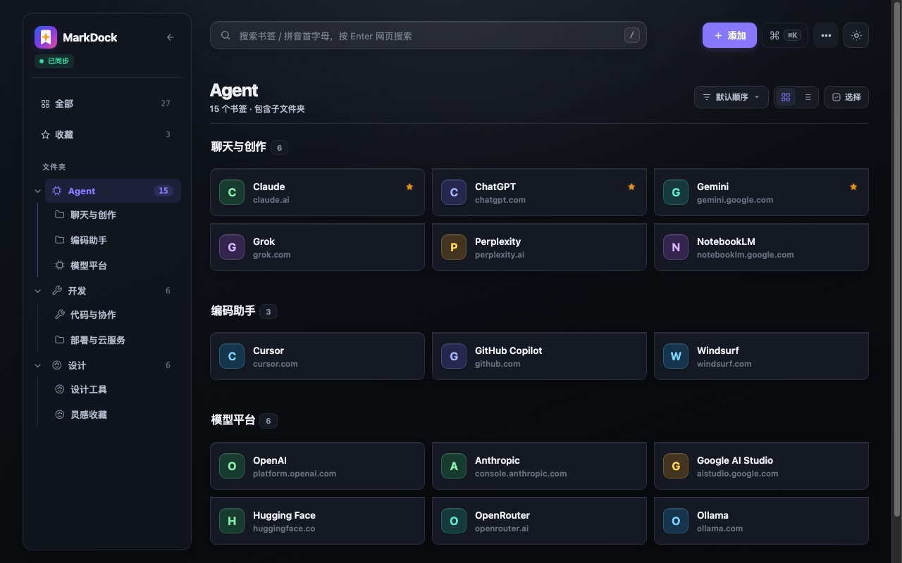
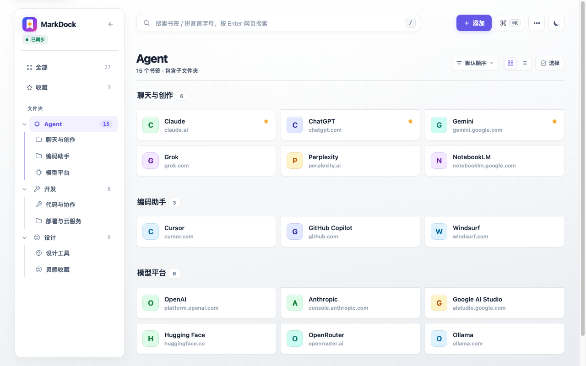
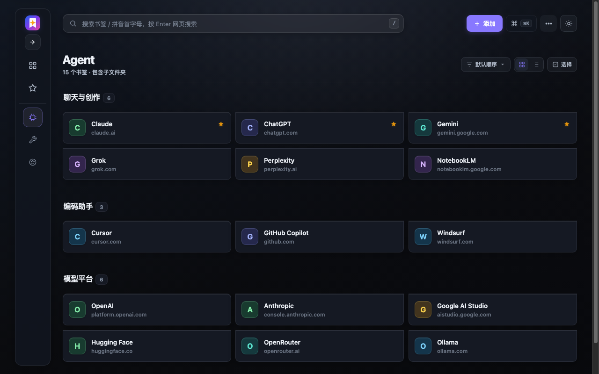
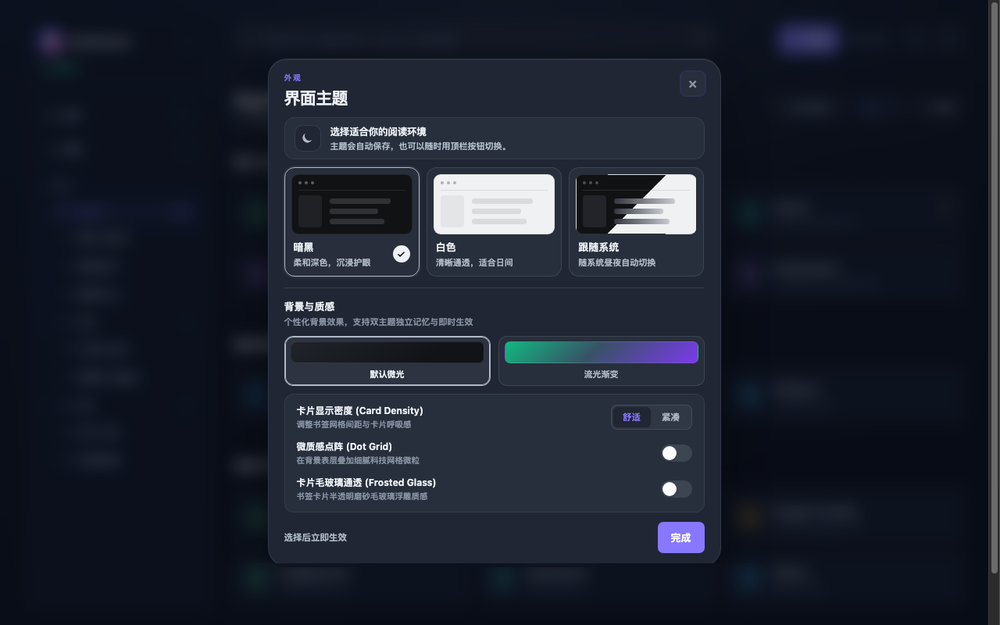

# MarkDock 书签坞 (MarkDock)

<p align="center">
  
</p>

<p align="center">
  <strong>现代化极简浏览器书签工作台与资产管理导航</strong>
  <br>
  <em>以呼吸感视觉、现代 macOS 风格 Dock 坞与全键盘极速流，重构 Chromium 书签浏览体验</em>
</p>

<p align="center">
  <a href="https://thevipsong.github.io/markdock/">
    
  </a>
  <a href="https://github.com/thevipsong/markdock/blob/main/LICENSE">
    
  </a>
  <a href="manifest.json">
    
  </a>
  
</p>

<p align="center">
  <a href="https://thevipsong.github.io/markdock/"><strong>🌐 在线体验 Web Demo</strong></a> •
  <a href="#-核心特性--features"><strong>✨ 核心特性</strong></a> •
  <a href="#-快捷键导航--keyboard-shortcuts"><strong>⌨️ 快捷键</strong></a> •
  <a href="#-安装与使用--installation"><strong>🚀 安装指南</strong></a> •
  <a href="https://thevipsong.github.io/markdock/privacy.html"><strong>🔒 隐私政策</strong></a>
</p>

---

<p align="center">
  <a href="https://thevipsong.github.io/markdock/">
    
  </a>
</p>

> 💡 **无需安装扩展，即可在线免登录试用！**  
> 点击上方图片或访问 **[thevipsong.github.io/markdock](https://thevipsong.github.io/markdock/)**，即刻在浏览器中体验 4 列响应式栅格卡片、Dock 悬停穿透、多色流光空间与全键盘极速操作。

---

## 📖 简介 / Overview

传统浏览器书签栏长期存在**“目录层层折叠、视觉拥挤杂乱、查找效率低下”**的痛点。**MarkDock 书签坞** 旨在为专业信息整理者、开发者与数字游民提供一套通透、纯净、极速的书签管理工作台：

* 🚀 **通透呼吸感栅格**：4 列响应式自适应卡片布局，完整呈现长域名与子目录路径，彻底消除过度截断；
* 🪟 **macOS 风格现代 Dock 坞**：一键将复杂目录树收缩为 42px 紧凑 Dock，悬停即滑出毛玻璃信息卡与多级穿透；
* 🎨 **沉浸双主题与多色空间流光**：低光环境下沉浸深邃，高亮环境下温润纯净，搭配 6 套高级空间流光渐变与点阵科技微质感；
* ⚡ **全键盘检索与聚合网页搜索**：拼音首字母检索、英文首字母缩写、全局指令台（`⌘K` / `Ctrl+K`），一键聚合直达多主流搜索引擎；
* 🔄 **Chromium 原生书签自动实时双向同步**：底层原生打通 Chrome / Edge Bookmarks API，增删改移实时写回，无外部云端中转，100% 数据留存于本地。

---

## 📸 界面预览 / Screenshots

### 🌓 极简通透的双主题架构 (Dark & Light Mode)
> 无论是暗黑环境下的沉浸阅读，还是日间高亮下的温润纯白，均具备出色的色彩过渡与呼吸感层次。

| 🌙 暗黑极客模式 (Dark Mode) | ☀️ 纯白优雅模式 (Light Mode) |
| :---: | :---: |
|  |  |

---

### 🚀 极简现代 Dock 坞与毛玻璃飞出卡片 (Dock Flyout)
> 一键折叠侧边栏为 42px 精致 Dock 坞；鼠标轻悬任一节点即平滑滑出毛玻璃信息卡，支持全名与多级子目录穿透点击直达。

<p align="center">
  
</p>

---

### 🎨 沉浸式外观背景与个性化质感 (Appearance & Themes)
> 支持暗黑沉浸、白色纯净与跟随系统三模式；内置 6 款高雅多色流光空间渐变；更有点阵微质感科技网格与卡片毛玻璃通透浮雕质感。

<p align="center">
  
</p>

---

## ✨ 核心特性 / Features

### 1. 🪟 极简现代 Dock 坞与智能飞出卡片
- **折叠状态极简规整**：一键收起侧栏后自动隐藏树状缩进线与深层嵌套，转换为精致的居中圆角卡位 Dock 坞，提供活动项微光指示点（Accent Dot）。
- **智能毛玻璃飞出卡片（Dock Flyout）**：鼠标悬停任一 Dock 节点即刻平滑滑出毛玻璃信息卡，展示文件夹全名、书签总数与深层子目录列表，支持一键穿透直达。
- **平滑避让排版**：侧边栏文件夹悬停时数字徽标平滑左移让位，彻底消除操作按钮（`···`）与书签数量碰撞。

### 2. 🎨 通透悬浮布局与精致视觉降噪
- **通透悬浮顶栏**：打通顶部 Header 外框，Logo 与搜索胶囊自然悬浮于画布背景，空间感彻底展开。
- **100% 完整域名呈现**：卡片子目录标签移至标题行右上角，第二行独占 100% 宽度，局域网 IP、端口与长域名不再被过度截断。
- **自适应高清 Favicon 引擎**：自动嗅探网站高清 Web App 图标与 SVG，低对比度背景保护与字符兜底，告别模糊失真。
- **品牌大小写自动规范**：智能校正常用科技与社交品牌英文大小写（如 Twitter、GitHub、ChatGPT、Jellyfin 等），卡片排版井然有序。

### 3. ⚡ 极速搜索与全局指令台 (Command Palette)
- **拼音与缩写匹配**：支持中文拼音首字母检索（如输入 `blbl` 搜索 `哔哩哔哩`），英文首字母缩写（如 `Windows Desktop` 搜 `WD`）。
- **聚合搜索引擎切换**：在搜索框直接按回车一键跳转 Google、Bing、百度、DuckDuckGo 等聚合网页搜索。
- **全局指令台**：随时按下 `⌘K` 或 `Ctrl+K` 快速呼出全局操作面板，支持快速跳转、站点聚合检索与设置项切换。

### 4. 🔄 Chromium 书签自动双向同步
- **深度集成浏览器原生 Bookmarks API**：增删改移实时自动写回 Chrome / Edge。
- **统一数据源**：告别多来源切换困扰，打开即是最新收藏夹。
- **Chrome Sync 跨设备同步**：支持同步视图、排序、密度和侧栏折叠等个性化工作台偏好。

### 5. 🛠️ 专业管理与体检工具
- **重复书签查重**：智能识别同 URL / 同名重复书签，一键安全合并与批量清理。
- **死链与失效检测**：安全按需探测 HTTP 404 / 410 失效书签，保护私网目标不越权。
- **备份与恢复**：支持标准 HTML 书签导入导出与完整 JSON 配置备份。

---

## ⌨️ 快捷键导航 / Keyboard Shortcuts

MarkDock 针对键盘重度用户进行了全链路快捷键支持：

| 快捷键 | 功能动作 | 说明 |
| :--- | :--- | :--- |
| <kbd>⌘K</kbd> / <kbd>Ctrl+K</kbd> | **唤起全局指令台** | 快速执行指令、搜索书签或按域名聚合检索 |
| <kbd>/</kbd> | **聚焦搜索框** | 任意界面一键直达顶部搜索框 |
| <kbd>j</kbd> / <kbd>k</kbd> | **卡片快速遍历** | 在书签列表中向下 / 向上移动选中聚焦项 |
| <kbd>↑</kbd> <kbd>↓</kbd> <kbd>←</kbd> <kbd>→</kbd> | **网格四向导航** | 响应式 4 列卡片之间顺畅切换焦点 |
| <kbd>Enter</kbd> | **打开选中书签** | 在新标签页打开当前聚焦的书签 |
| <kbd>Esc</kbd> | **取消 / 返回** | 清空搜索、取消多选或关闭当前打开的对话框 |

---

## 🚀 安装与使用 / Installation

### 方式一：在线免安装体验 (Web Demo)
直接访问 GitHub Pages 在线演示站点：  
👉 **[https://thevipsong.github.io/markdock/](https://thevipsong.github.io/markdock/)**

---

### 方式二：以 Chrome / Edge 扩展程序运行（推荐）

本项目严格遵循 **Chromium Manifest V3** 标准规范，100% 原生支持 **Google Chrome**、**Microsoft Edge**、**Brave**、**Arc** 等现代 Chromium 浏览器：

#### Chrome 浏览器：
1. 打开 Chrome，在地址栏输入：`chrome://extensions/`
2. 打开右上角的 **「开发者模式」** 开关；
3. 点击左上角的 **「加载已解压的扩展程序」**；
4. 选择本项目所在文件夹即可完成安装。

#### Edge 浏览器：
1. 打开 Edge，在地址栏输入：`edge://extensions/`
2. 在左侧边栏底部开启 **「开发人员模式」** 开关；
3. 点击主界面顶部出现的 **「加载解压缩的扩展」** 按钮；
4. 选择本项目所在文件夹即可完成安装。

> 💡 **使用小贴士**：安装完成后，建议在浏览器右上角的拼图扩展菜单中将 **MarkDock** 固定在工具栏，或使用快捷键 `Command+Shift+Y` (Mac) / `Alt+Shift+B` (Windows) 一键快速呼出工作台。

---

### 方式三：本地独立 Python 服务运行（可选）

MarkDock 附带了基于 Python 3 标准库实现的本地开发与离线服务脚本（无需安装任何第三方 pip 依赖）：

```bash
# 启动本地服务
python3 serve.py
```
终端启动后，在浏览器访问 `http://127.0.0.1:8765` 即可使用。

---

## 🔒 隐私透明与安全规范 / Privacy & Security

MarkDock 将用户数据隐私置于首位：

* **书签留存于本地**：扩展通过 Chrome 官方 Bookmarks API 在本机读取和管理书签，**绝不上传书签数据至任何开发者服务器**。
* **无远程代码**：所有 JavaScript 均打包于本地扩展包中运行，绝不执行外部远程脚本，符合最严苛的 Manifest V3 安全标准。
* **零分析与广告**：无任何第三方跟踪 SDK、无数据埋点、无商业广告。
* **有限的设置同步**：仅使用 `chrome.storage.sync` 同步界面视图模式、排序方式、卡片密度和侧栏展开状态，不上传任何私密书签内容。
* **安全按需网络请求**：
  * 高清 Favicon 仅向书签对应站点直接请求图标资源，不携带 Referer；
  * 失效链接检查仅在用户主动触发并明确授权后方可按需检测，检测时不携带登录 Cookie。

📄 详细的隐私权做法说明，请参阅在线政策文档：[MarkDock 隐私政策](https://thevipsong.github.io/markdock/privacy.html)。

---

## 📄 开源许可 / License

本项目基于 [MIT License](LICENSE) 开源协议分发与维护。欢迎提交 Issue 与 Pull Request！
